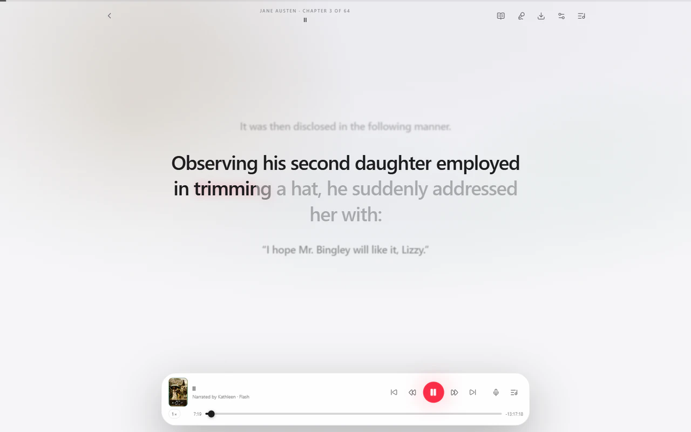
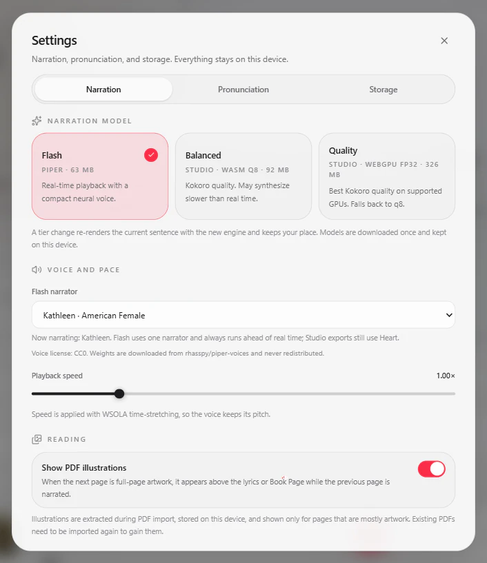
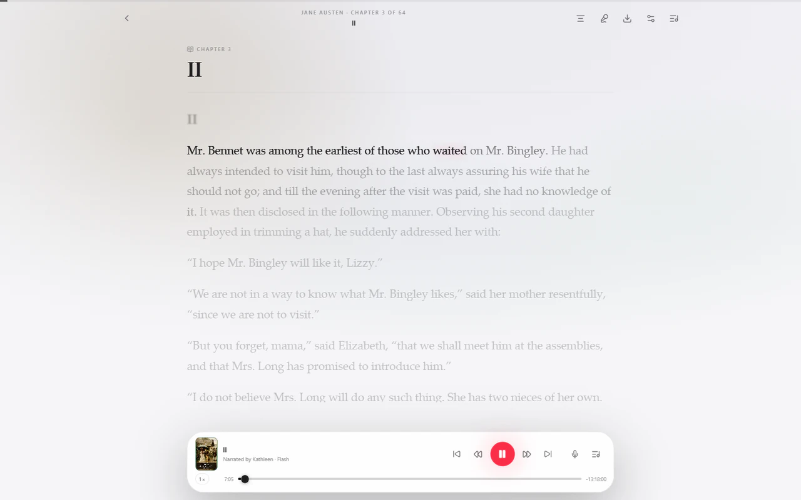
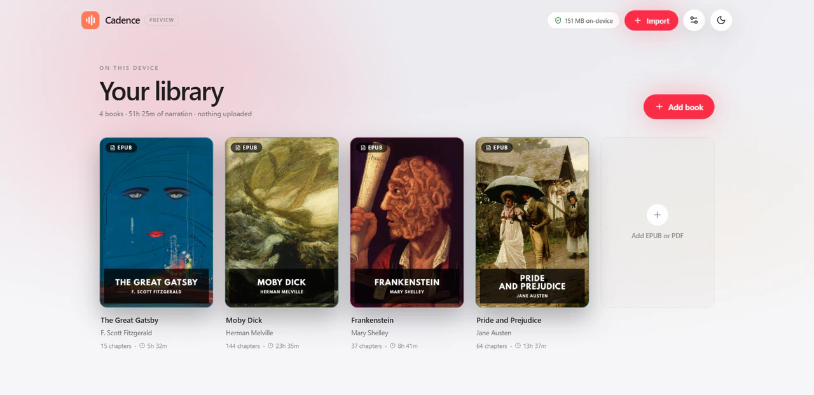
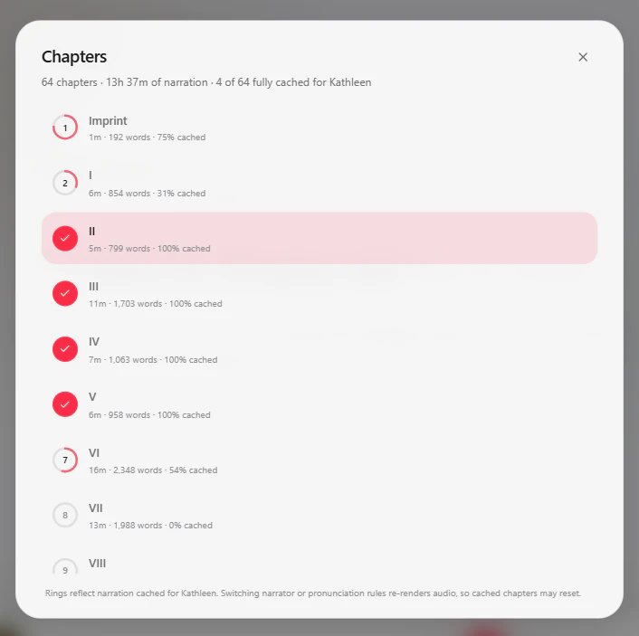
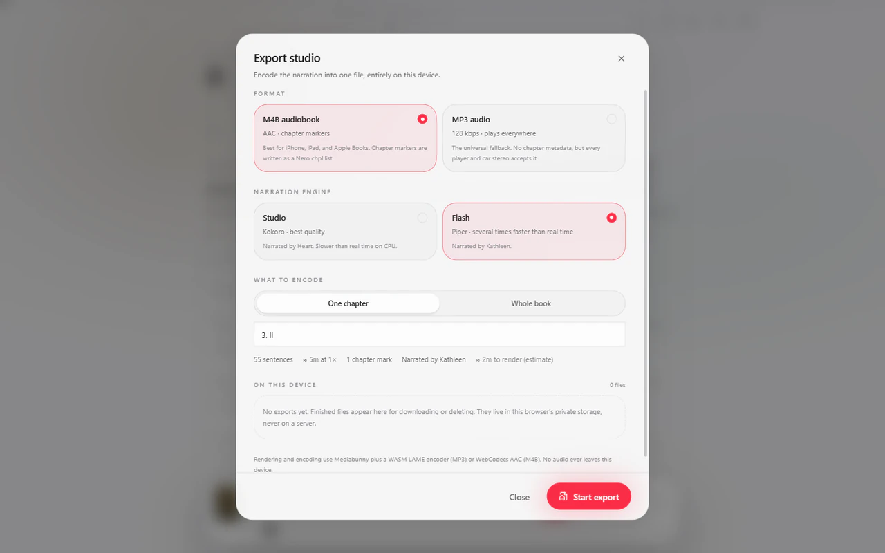
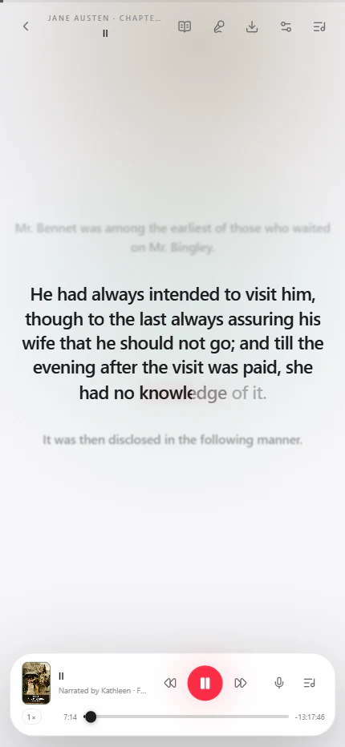

<p align="center">
  
</p>

<h1 align="center">Cadence</h1>

<p align="center">
  <strong>Your whole library, read aloud — without leaving the browser.</strong><br />
  EPUB and PDF books become audiobooks with two local neural narration engines, word-level
  Live Lyrics, and one-click MP3/M4B export. No account, no upload, no server.
</p>

<p align="center">
  <a href="https://cadenceaudio.vercel.app/"><strong>Open Cadence →</strong></a>
</p>



## Everything stays on your device

Cadence runs the whole audiobook pipeline — parsing, phonemization, neural inference, word
timing, time-stretching, and encoding — on your device. Books, rendered narration, and
reading positions live in the browser's private file system, so nothing is uploaded and
nothing needs an account. The only network requests are the one-time downloads of the
narration models and voices.

## Two ways to be read to

| | **Flash** | **Studio** |
|---|---|---|
| Engine | Piper/VITS, 22.05 kHz | Kokoro-82M |
| Voices | Six fixed narrators | Kokoro catalog plus 3-voice blending |
| Speed | Faster than real time (~2.4× on a laptop CPU) | Rich prosody; needs WebGPU to stay ahead of playback |
| Best for | Long books, phones, all-day listening | The best sound your hardware can produce |

Flash is the default: a 63 MB voice downloads once, then narrates in real time with no
network. Studio is one tap away for the richest prosody, uses WebGPU when the browser
offers it, and falls back to quantized WASM. Switch engines mid-book and your place is
kept.

<p align="center">
  
</p>

## Features

**Live Lyrics, word by word.** The current sentence sits center stage and fills word by
word in sync with the audio, with the previous and next lines blurred behind it. All of
that is driven from `requestAnimationFrame` straight to CSS, so the UI holds 60fps while
audio plays.

**Book Page.** Prefer reading along? The full chapter renders as a book page, the active
sentence is illuminated, and the view auto-scrolls as narration moves — with a resume pill
the moment you scroll away. Tap any sentence to seek there.



**Your bookshelf, on this device.** Drop in an EPUB or PDF and Cadence extracts the cover,
builds a color palette from the artwork, and shows the chapter count and narration length
before you start. EPUB chapters come from the nav document or NCX; PDF chapters come from
the document outline, with a layout-aware fallback for books that don't have one.



Books with a text layer work best: scanned, image-only PDFs (no OCR) and DRM-protected
EPUBs are refused with a clear message rather than producing empty narration.

**Every chapter, ready when you are.** Narration is cached sentence by sentence as 16-bit
PCM, so a chapter you've heard starts instantly and a chapter you haven't shows a live cache
ring while it renders.

<p align="center">
  
</p>

**Speed without chipmunk.** 0.5× to 3×, applied with offline WSOLA time-stretching, so the
narrator keeps their pitch and the word timings stay aligned. The scrubber always reports
real playback time, and seeking is sentence-exact — including mid-sentence resumes after a
reload.

**Pronunciation, your way.** A longest-match lexicon for names and invented words
("Her-my-oh-nee"), plus toggles for abbreviations, citations, and URLs. Display text stays
untouched; only the spoken text changes, and cached audio is keyed to it so a rule change
never reuses a stale rendering.

**Illustrations, kept.** PDF pages that are mostly artwork are detected during import,
rendered to JPEG, and pinned above the lyrics while the facing page is narrated. EPUB
covers become the shelf artwork, and both are stored with the book.

**Export that plays anywhere.** Render a chapter or a whole book to MP3 (128 kbps, universal)
or M4B (AAC with Nero chapter markers for Apple Books), with Flash or Studio as the narrator.
Encoding streams through a worker straight into private storage, so a long book never sits
in memory.



**Private by architecture.** No backend to leak to. No analytics. No fonts or scripts from
third parties. Pronunciation rules, progress, and settings live in IndexedDB; audio and
books live in OPFS; clearing site data removes all of it.

## On a phone

The player is responsive down to small screens, with safe-area-aware controls and a
MediaSession lock-screen panel, and Flash is fast enough to keep a phone's CPU ahead of the
narrator.

<p align="center">
  
</p>

## Run it locally

Requires Node 24+ and npm 11+.

```bash
npm install
npm run dev
```

Open the printed URL. The dev server sets the COOP/COEP headers that threaded WASM needs;
without them Cadence still works, just with a single WASM thread.

```bash
npm run build     # static production build in dist/
npm run preview   # preview the build with the same headers
npm run typecheck && npm run lint && npm run test
```

## Deploy

Cadence is a static Vite app with no server code or environment variables. The live demo
runs on Vercel, which serves `dist/` and sets COOP/COEP on every route. To deploy your own
copy, import the repository at [vercel.com/new](https://vercel.com/new) or run:

```bash
npx vercel --prod
```

Any static host works; hosts that cannot set cross-origin isolation simply lose multi-threaded
inference. For a subpath deployment, build with `VITE_BASE=/your-path/`. See
[`vercel.json`](./vercel.json) and [`netlify.toml`](./netlify.toml) for reference configs.

## Narration voices

Flash ships six 22.05 kHz Piper "medium" voices, downloaded on first use (about 63 MB each):

| Voice | License |
|---|---|
| `en_US-kathleen-medium` (default) | CC0 |
| `en_US-amy-medium` | CC BY-SA 4.0 |
| `en_GB-alba-medium` | CC BY 4.0 |
| `en_US-joe-medium` | CC0 |
| `en_US-norman-medium` | public domain |
| `en_GB-northern_english_male-medium` | CC BY-SA 4.0 |

Voices are fetched at runtime from [`rhasspy/piper-voices`](https://huggingface.co/rhasspy/piper-voices)
and their licenses stay with the voice authors. Studio uses the built-in Kokoro-82M voice
catalog. Exports can be rendered with either engine, and cached audio is keyed by engine,
voice, and speech settings so renderings never mix.

## Under the hood

- Vite 7, React 19, TypeScript 5.9, Tailwind CSS v4, Motion
- Zustand + Immer, IndexedDB via `idb`, Origin Private File System for audio and book files
- ONNX Runtime Web for both engines: `kokoro-js` for Studio, direct Piper/VITS inference for Flash
- `phonemizer` with bundled eSpeak NG for pronunciation, shared by both engines
- `pdfjs-dist` for PDF text/layout extraction, JSZip + `fast-xml-parser` + `linkedom` for EPUB
- Mediabunny with a WASM LAME encoder and WebCodecs AAC for export
- Comlink module workers for parsing, synthesis, export, and WSOLA

Deeper notes on the architecture, storage layout, and measured performance live in
[`AGENTS.md`](./AGENTS.md).

## License

TBD.
